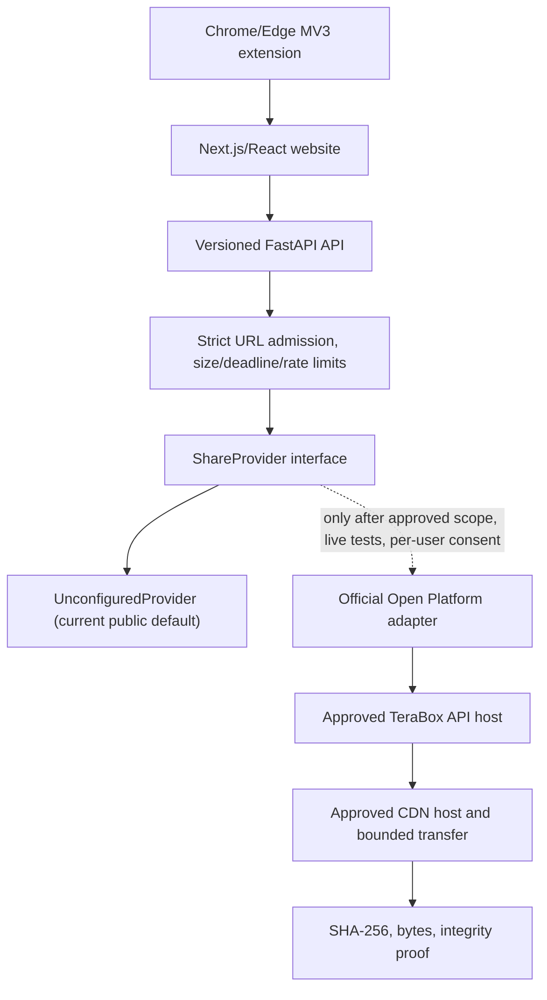

# START HERE — Permanent Project Handoff
## Independently operated TeraBox Downloader website, extension and FastAPI platform

**Last assembled:** 2026-11-16 (Asia/Kolkata). **Repository:** https://github.com/kawakaze430/create-terabox-downloader
**Audited source revision:** `5304ce3292c39ff530059cf5f1f339269cdc8dde` (prior to the archive commit).
**Read first:** [AGENTS.md](../AGENTS.md) · [Chat history](PROJECT_CONVERSATION_ARCHIVE.md) · [Original 1,160-line master prompt](MASTER_DEVELOPMENT_PROMPT_2026-11-15.md) · [Source document index with immutable GitHub revision links](PROJECT_SOURCE_INDEX_2026-11-16.md).

> **Fundamental truth:** This is an EXISTING monorepo; DO NOT restart, fork into unrelated frameworks, or falsely claim real downloads work. **G1 is blocked:** no verified, partner-authorized live metadata and no completed SHA-256-verified TeraBox transfer. The public API intentionally remains unconfigured. Actual repo code and latest CI outweigh old docs and chat summaries.

## 1. Mission and vision

Create an **independently branded, competitive, secure, reliable TeraBox downloader/preview product**, owned and operated via our own GitHub, hosting, domain, infrastructure, secrets, support and release workflows. A high-quality website, Chrome/Edge extension and shared versioned backend must use one coherent provider/contract layer. Use relevant ideas from licensed public references, but never copy whole third-party apps or depend on strangers' proxies/cookies.

**Main user journey:** paste a permitted share link → validate the URL without fetching arbitrary addresses → obtain real authorized filename/size/file listing → preview supported formats → download via a permitted mechanism → accurately report completed transfer and integrity. Fail clearly on expired, protected, inaccessible, unsupported or unavailable links. No invented file URLs, qualities, thumbnails or progress.

### Logical product architecture



### Target milestones: planned vs proven

| Gate | Planned functionality | Actual evidence |
| --- | --- | --- |
| G0 | docs, monorepo, research, API/website/extension scaffolds | Present and offline-tested |
| G1 | authorized TeraBox metadata + **completed real checksum-matched download** | **BLOCKED** (provider access / approvals / fixture) |
| G2 | actual file metadata cards, browser handoff/download, permitted thumbnails/video/audio previews, folder, bounded batch/ZIP | NOT implemented/live-tested |
| G3 | deployment, HTTPS, production quotas, privacy, monitoring, cross-browser and security validation | Deferred |
| G4 | full playback/PiP/qualities offered by provider, folder search, bookmarks/history, localization | Deferred |
| G5 | accounts, public API plans, premium/billing, admin/analytics, extra devices | Deferred until proven core |

## 2. What is already in the repository

| Location | Verified current behavior / remaining boundary |
| --- | --- |
| `services/api/app/main.py` | `GET /healthz`, `GET /readyz`, `POST /api/v1/shares/validate`, `POST /api/v1/shares/resolve`. Disabled provider returns HTTP 501 `PROVIDER_NOT_CONFIGURED`; readiness 503 |
| `links.py` | Offline exact-host HTTPS allowlist, supported `/s/<token>` and `/sharing/link?surl=<token>` paths; no HTTP fetch |
| `models.py`, `provider.py` | Pydantic strict metadata/capability models, typed errors and injected provider protocol; public provider unconfigured |
| `limits.py` | per-process rate/concurrency admission, bounded JSON body/deadlines, safe errors and privacy headers; multiworker needs ingress quotas |
| `open_platform.py` | operator/partner-credential OAuth scaffold, documented fixed endpoints, regional host approval, malformed input rejection; **offline only** |
| `official_shares.py` | candidate owner-only share metadata/link client and checksum comparison; mock-tested, deliberately not public |
| `preflight.py` | offline configuration report; `--live` opt-in gated on private approval/fixtures |
| `egress.py` | exact approved host HTTPS, public DNS, checked-IP pinning and SNI, no arbitrary redirects/proxies |
| `apps/web/app/page.tsx` | mobile-friendly paste/validate/status, abort stale requests, fragment handoff and truthful 'downloads coming' state; NO player or live files |
| `apps/extension/` | Manifest V3 popup, strict URL parser, supported-page handoff to localhost dev website; NO installed-store release verification |
| `services/api/tests/` | 173 offline Python tests passed on CI implementation checkpoint; upstream provider is mocked |
| `apps/web/tests/` | 10 Playwright desktop/mobile Chromium flows passed; disabled-provider/validation only |
| `apps/extension/tests/` | 16 extension parser tests; no published extension proof |
| `PUBLIC_REPOSITORY_STUDY_LIST.txt` | **49 public GitHub repository links**, categorized and caveated; not 49 ready-to-use download engines |

Existing URL allowlist: `terabox.com`, `www.terabox.com`,
`teraboxapp.com`, `www.teraboxapp.com`,
`1024terabox.com`, `www.1024terabox.com`,
`terasharefile.com`, `www.terasharefile.com`.
Don't import a broader list from third-party projects without verifying provider domains.

## 3. Latest verified GitHub state and reproducible checks

**As of original audit on 2026-11-16:** `main` SHA `5304ce3292c39ff530059cf5f1f339269cdc8dde`,
**zero open PRs**, issue #2 open. GitHub PRs [#1](https://github.com/kawakaze430/create-terabox-downloader/pull/1),
[#3](https://github.com/kawakaze430/create-terabox-downloader/pull/3) and
[#4](https://github.com/kawakaze430/create-terabox-downloader/pull/4) are merged.
[Workflow 43750728308](https://github.com/kawakaze430/create-terabox-downloader/actions/runs/43750728308)
passed at baseline. [Implementation workflow 43750414786](https://github.com/kawakaze430/create-terabox-downloader/actions/runs/43750414786)
passed at commit `8203a017`: **173 backend tests, 16 extension tests,
10 Playwright browser tests**, Next.js production build/typecheck,
Python checks, and operator **OFFLINE** preflight. CI is NOT evidence of a
live TeraBox file download.

```bash
# At repo root, Python 3.12+
python -m pip install -r services/api/requirements.lock
PYTHONPATH=services/api python -m pytest -q services/api/tests
PYTHONPATH=services/api python -m app.preflight   # OFFLINE only; exit 2 if unconfigured
python -m pip check

# Node.js 22+
node --check apps/extension/popup.js
node --test apps/extension/tests/*.test.mjs

# Web; see docs/LOCAL_DEVELOPMENT.md and CI
cd apps/web
npm ci --no-audit --no-fund
npm run build
npm run typecheck
npx playwright install --with-deps chromium
npm run test:e2e
```

## 4. G1 blocker and exact authorized acceptance procedure

**Issue:** https://github.com/kawakaze430/create-terabox-downloader/issues/2
**Official partner application:** https://www.terabox.com/integrations
**Official docs:** https://www.terabox.com/integrations/docs?lang=en
**Handoff:** [OFFICIAL_OPEN_PLATFORM.md](OFFICIAL_OPEN_PLATFORM.md)
**Runbook:** [OPERATOR_VALIDATION.md](OPERATOR_VALIDATION.md)

The official docs describe partner OAuth with authorization code/device code,
`/oauth/gettoken`, `/oauth/refreshtoken`, `/oauth/tokeninfo`,
regional `api_domain`/`upload_domain`, and share-related interfaces
(`/openapi/share/list`, `/openapi/share/verify`,
`/openapi/share/download`, `/openapi/share/mediameta`).
*Documentation exists, but does not establish permission for the intended
general-public, commercial or third-party share workflow.*
The operator candidate uses `/openapi/api/shorturlinfo` and
`/openapi/share/download`. Inconsistent doc fields (`access_token` vs
`access_tokens`; `fs_id` vs `fid_id`) require partner-approved live
evidence, not guessed cookie/worker fallbacks.

**To finish G1, the owner needs privately:** written partner approval for
exact scope and commercial external-share operations, three partner app
credentials, a consented access token, TeraBox-approved exact regional API and
download hosts, and a small non-sensitive owner-owned share with selected
file ID, expected length and independently computed SHA-256. Never put
secrets in this public repo, chat, issue, PR or frontend/extension.

Operator runs `PYTHONPATH=services/api python -m app.preflight` to see
missing *variable names* (never values). **Do NOT run `--live`** until
permission, token, region/CDN and test fixture requirements are satisfied.
Only then run `PYTHONPATH=services/api python -m app.preflight --live`
with an approved small test file (max 10 MiB), record actual upstream
metadata, complete downloaded bytes, checksum match, date, commit and
sanitized logs in the implementation log. A single successful fixture does
not safely authorize anonymous visitor downloads—design individual user
consent, token isolation and permission boundaries first.

## 5. Two — exactly two — main source-repository references

| Repository | Audited revision / license | Useful source | Do not import |
| --- | --- | --- | --- |
| [TeraPlayer](https://github.com/gitmarcus07/Teraplayer) | `2e60ba4b4963a4112aab57eb2d4770175c5f9965`; MIT LICENSE file | `frontend/src/components/FolderBrowser.jsx`, `VideoPlayer.jsx`; `backend/server.py`; extension; UX states | `backend/services/extractors.py` public third-party API/worker fallback, cookies in `terabox.py`, MongoDB/admin bloat, branding |
| [TeraBox Gateway](https://github.com/saahiyo/terabox-gateway) | `063f61fc61bb173fb936fc487f4a18e40436caab`; MIT LICENSE file | `src/terabox_gateway/{api,terabox_client,config,utils,cache,rate_limiter}.py`; TTL/failure patterns | Flask rewrite, fixed external worker, optional session cookies, raw URL cache logging, trusted incoming forwarded headers |

Neither repository's advertised downloads were validated with our own live
authorized file. No third-party source was copied. Keep the existing
FastAPI/Next.js/HTTPX/Pydantic architecture, adapt *patterns* after G1.
Full original 49 URL research list: [PUBLIC_REPOSITORY_STUDY_LIST.txt](../PUBLIC_REPOSITORY_STUDY_LIST.txt),
with all source links and priority/license warnings.

## 6. Strictly ordered immediate implementation checklist

| Priority | Task, location | Completion proof / blocker |
| --- | --- | --- |
| 1 | Partner approval/scopes `docs/OFFICIAL_OPEN_PLATFORM.md` | Written permissions + quotas; **external blocker** |
| 2 | Non-sensitive operator fixture `docs/OPERATOR_VALIDATION.md` | Trusted own-file SHA-256, ID, allowed region; **external blocker** |
| 3 | Real metadata `app/official_shares.py` | Actual ID/name/size; blocked by 1–2 |
| 4 | Completed authorized transfer `app/preflight.py` + `app/egress.py` | True bytes and matching SHA-256; blocked by 1–2 |
| 5 | OAuth token and code validation `app/open_platform.py` | **Implemented:** commit `8203a017`, 173 offline tests |
| 6 | More DNS/SSRF/redirect/transfer regression tests `app/egress.py`, `tests/test_egress.py` | Feasible now with MockTransport/synthetic DNS |
| 7 | Per-user permission design `app/provider.py`, `app/open_platform.py` | Private user-scoped token lifecycle; design can start |
| 8 | Map actual approved provider response to models `app/models.py` | Requires real approved sample |
| 9 | Truthful metadata cards, preview, download UI `apps/web` | Requires verified provider and secure public API |
| 10 | Browser/store release and production staging `apps/extension`, CI/docs | Requires verified core and owned infrastructure |

**Next feasible engineering job without partner credentials:** strengthen
negative security/regression tests around outbound egress, DNS rebinding,
malformed HTTP and bounded transfers, not billing, ads, thumbnails, quality
buttons or other unverified feature inflation.

## 7. Security and architecture contracts

- Do not bypass CAPTCHA, login/auth, DRM, subscriptions, premium controls or quotas.
- No borrowed NDUS/session cookies, uncontrolled Cloudflare Worker, scraped
  anonymous endpoints, password sharing or public reusable proxy.
- Exact hostname/IP/redirect checks, DNS rebinding protection, TLS/SNI,
  finite deadlines, byte/count/ZIP bounds, fixed client authorization,
  rate/concurrency controls and egress firewall.
- No sensitive raw upstream URL, token, credential, share password, file
  content or private data in logs, errors, CI, PRs or public storage.
- No invented video resolution/preview, unsupported folders or false file completion.
- Preserve v1 API compatibility unless a justified and tested change; never
  replace functioning code just to mirror reference project.
- Production accessibility/mobile/privacy/legal/safety and copyright reporting
  before independent release; no premium billing before core proof.
- Strict separation between offline mocks, implemented-but-unverified, live
  authorized verification and production readiness.

## 8. Project history, decisions, code links and CI

| When | Verifiable event | Link |
| --- | --- | --- |
| 2026-11-13 | Foundation PR #1 merged; early 20 offline backend tests | https://github.com/kawakaze430/create-terabox-downloader/pull/1 |
| 2026-11-14 | Typed provider contract PR #3 merged; official OAuth scaffold PR #4 merged | https://github.com/kawakaze430/create-terabox-downloader/pull/3 and https://github.com/kawakaze430/create-terabox-downloader/pull/4 |
| 2026-11-14 to 15 | Operator preflight and token validation; eventually 158 offline backend + 16 extension + 10 Playwright | https://github.com/kawakaze430/create-terabox-downloader/actions/runs/43650665747 |
| 2026-11-15 | Comprehensive 49-link public research list published | https://github.com/kawakaze430/create-terabox-downloader/commit/873eba5e6d24cad6a5fb2e37a6eb9476db8af361 |
| 2026-11-16 IST | OAuth outbound token validation regression tests; 173 backend tests | https://github.com/kawakaze430/create-terabox-downloader/commit/8203a017032516e9ae30a9790fc141752604880a |
| 2026-11-16 IST | Reference audit, roadmap, implementation log and docs updated; CI green | https://github.com/kawakaze430/create-terabox-downloader/commit/5304ce3292c39ff530059cf5f1f339269cdc8dde |
| 2026-11-16 IST | Permanent project handoff and chat archive requested | This document and linked archives |

**Navigation:** [AGENTS](../AGENTS.md), [README](../README.md),
[Requirements](PRODUCT_REQUIREMENTS.md), [Architecture](ARCHITECTURE.md),
[Roadmap](ROADMAP_AND_QA.md), [Checklist](IMPLEMENTATION_CHECKLIST.md),
[Implementation Log](IMPLEMENTATION_LOG.md), [Official API](OFFICIAL_OPEN_PLATFORM.md),
[Provider feasibility](PROVIDER_FEASIBILITY.md), [Operator validation](OPERATOR_VALIDATION.md),
[Licenses/research](RESEARCH_AND_LICENSES.md), [Local dev](LOCAL_DEVELOPMENT.md),
[49 full study URLs](../PUBLIC_REPOSITORY_STUDY_LIST.txt),
[exact frozen source links](PROJECT_SOURCE_INDEX_2026-11-16.md).

## 9. Copy this into any future ChatGPT/Codex session

> Continue the **existing** GitHub repository `https://github.com/kawakaze430/create-terabox-downloader`.
> First read `docs/START_HERE_PROJECT_HANDOFF.md`,
> `docs/PROJECT_CONVERSATION_ARCHIVE.md`,
> `docs/MASTER_DEVELOPMENT_PROMPT_2026-11-15.md`, `AGENTS.md`,
> `docs/IMPLEMENTATION_CHECKLIST.md`,
> `docs/IMPLEMENTATION_LOG.md`,
> `docs/OPERATOR_VALIDATION.md`,
> and `PUBLIC_REPOSITORY_STUDY_LIST.txt`. Check latest source, PRs,
> issue #2, CI and current `AGENTS.md` before writing. We own one
> Next.js + FastAPI + Chrome/Edge MV3 product; **do not restart**. Public
> provider remains disabled until authorized live metadata and full
> checksum-matched transfer demonstrate G1. Exactly two main code study
> references: `gitmarcus07/Teraplayer`, `saahiyo/terabox-gateway`;
> no borrowed sessions/third-party proxies. Work in small verified steps;
> push directly to `main` under current owner rule, no branch/PR/force
> push; update checklist/log/handoff with commit, tests, issues and
> blocker. Do not ask me to explain the same project again.

## 10. Integrity and updating this handoff

This file preserves **all available project facts, decisions, charts,
research and key links** currently recoverable, with a separate verbatim
1,160-line user master prompt. It is **not** a complete export of all older
ChatGPT messages: inaccessible full transcripts must not be fabricated.
The [recoverable chat archive](PROJECT_CONVERSATION_ARCHIVE.md)
labels quotes versus summaries. The original canonical docs and source
live in the repository; [source index](PROJECT_SOURCE_INDEX_2026-11-16.md)
pins their 2026-11-16 pre-archive versions. Update the handoff, checklist
and log as future code changes, and never commit personal secrets.
